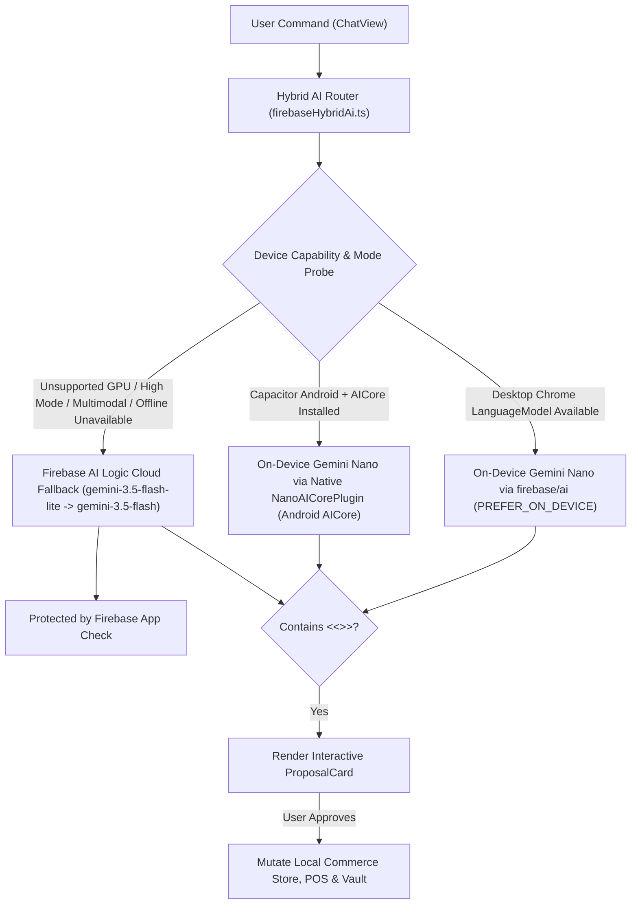

# SERA NanoMind | Hybrid On-Device & Cloud Agentic Commerce OS

Built for the **#BuildHybridAI 2026** Google Firebase Hackathon.

**SERA NanoMind** is an offline-first agentic commerce operating system uniting a conversational AI command deck (**ChatView**) with a live **Marketplace**, **Merchant Store** (merchant management), **POS Cashier** (Point-of-Sale terminal with shifts, table management, and kitchen tickets), and **Courier Dispatch** (store courier dispatch & COD settlement).

- **Live Web App:** [https://sera-nanomind.web.app](https://sera-nanomind.web.app)
- **Android APK (`v1.0.0`):** [Download from GitHub Releases](https://github.com/seraos-agent/sera-nanomind/releases/tag/v1.0.0)
- **Source Repository:** [https://github.com/seraos-agent/sera-nanomind](https://github.com/seraos-agent/sera-nanomind)

Powered by **Firebase AI Logic Hybrid Inference (`firebase/ai`)**, **Android AICore (`com.google.ai.edge.aicore`)**, and **Firebase App Check (`firebase/app-check`)**, SERA NanoMind prioritizes on-device execution via **Gemini Nano** for zero-cost, privacy-preserving store intelligence and seamlessly falls back to **Gemini 3.5 Flash Lite / Flash** in Firebase Cloud when hardware, offline, or deep-reasoning constraints require it.

---

## Hybrid AI Architecture



---

## Key Modules & Capabilities

| Module | File / Entry | Role |
| :--- | :--- | :--- |
| **Hybrid AI Router** | `src/services/firebaseHybridAi.ts` | Routes between on-device Gemini Nano (`PREFER_ON_DEVICE` / native Android AICore) and Firebase Cloud (`gemini-3.5-flash-lite` -> `gemini-3.5-flash`), plus `PREFER_IN_CLOUD` deep reasoning mode. |
| **Android AICore Bridge** | `android/app/src/main/java/xyz/seraos/app/NanoAICorePlugin.java` | Capacitor native Java bridge integrating `com.google.ai.edge.aicore:aicore:0.0.1-exp02` for on-device Gemini Nano inference on supported Android hardware. |
| **Firebase App Check** | `src/services/firebaseHybridAi.ts` | Initializes `initializeAppCheck` with `ReCaptchaEnterpriseProvider` or debug token support for protected Firebase AI Logic calls. |
| **Actionable Proposals** | `src/components/chat/ProposalCard.tsx` | Parses conversational intents (`CREATE_PRODUCT`, `UPDATE_STOCK`, `CREATE_POS_ORDER`, `SCHEDULE_GOAL`) into human-in-the-loop approval cards. |
| **Encrypted Memory Vault** | `src/storage/DeviceMemoryVault.ts` | Persists chat continuity in **IndexedDB** encrypted with a non-extractable **Web Crypto AES-GCM 256-bit** key. |
| **Offline-First Commerce** | `src/services/localMarketApiInterceptor.ts` & `demoCommerceSeed.ts` | Pre-seeded with *Kopi NanoMind Roastery*, 8 catalog items, an open POS shift, 3 POS transactions, and active courier stops. |

---

## Commerce Modules

- **Chat Deck (`ChatView`):** Centralized conversational agent with live routing telemetry in **CognitiveProcessCard** (`On-Device Gemini Nano` vs `Cloud Fallback`).
- **Marketplace:** Storefront browser synced in real time with merchant inventory changes.
- **Merchant Store (`MerchantPage`):** Catalog, pricing, stock, order fulfillment, and operational setup.
- **POS Cashier (`CashierPage`):** Offline-ready POS terminal tracking cash drawer opening balance, QRIS/Cash splits, and shift reporting.
- **Courier Dispatch (`DriverPage`):** Delivery queue, COD collection tracking, and courier settlement.

---

## Quickstart (Local Development)

### 1. Install Dependencies
```bash
npm install
```

### 2. Configure Firebase (Optional `.env.local` or In-App UI)
Copy `.env.example` to `.env.local` and fill in your Firebase Web App credentials (with **Firebase AI Logic** and **App Check** enabled in your Firebase project):

```bash
cp .env.example .env.local
```

Alternatively, paste your `firebaseConfig` JSON directly inside the app under **Workspace -> Storage Vault & Hybrid AI**.

### 3. Run Locally
```bash
npm run dev
```

### 4. Production Web Build
```bash
npm run build
```

### 5. Android APK Build (Capacitor)
```bash
npm run build
npx cap sync android
cd android && ./gradlew assembleDebug
```

---

## Enabling Gemini Nano On-Device in Chrome Desktop
1. Open Chrome Desktop on a device meeting Chrome's on-device hardware requirements.
2. Visit `chrome://flags` and enable `#optimization-guide-on-device-model` and `#prompt-api-for-gemini-nano`.
3. Restart Chrome, open `chrome://components`, and click **Check for update** on **Optimization Guide On Device Model**.
4. SERA NanoMind will automatically detect `LanguageModel` availability and execute `InferenceMode.PREFER_ON_DEVICE` prompts locally.

---

## License
MIT License. See [LICENSE](./LICENSE).
